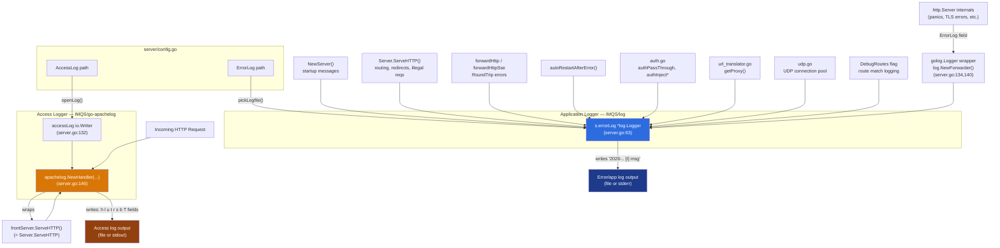

# Logging Architecture

The router writes logs through **two independent logging pipelines**, which is
why you'll see two different line formats in the output:

```
127.0.0.1 - - [20/Oct/2026:03:24:30 +0200] "GET /job/getjobs?type=wip&status=2 HTTP/1.1" 200 27 0.0048 None
2026-10-20T03:23:29.561391+0200 [I] HTTP RoundTrip error: dial tcp 127.0.0.1:2000: connectex: No connection could be made because the target machine actively refused it.
```

- The first line is an **Apache/Combined-style access log** entry, produced by
  the `github.com/IMQS/go-apachelog` middleware for *every* HTTP request.
- The second line is an **application/diagnostic log** entry, produced by the
  `github.com/IMQS/log` logger (`s.errorLog`), called explicitly from various
  places in the code whenever something noteworthy happens.

These are two different libraries with two different schemas — the access log
has no "level" field (the `- -` you see are the Apache `%l` ident and `%u` user
fields, not a blank severity level), while the app log always carries a level
indicator (`[I]`, `[W]`, `[E]`, etc.).

## Diagram



## Why they're split

- **Standard tooling compatibility** — Apache/Combined log format is what most
  log analyzers (GoAccess, AWStats, ELK pipelines, etc.) already expect for
  HTTP access auditing. Reinventing that format in the app logger would break
  compatibility with those tools.
- **Separate configuration/rotation** — `AccessLog` and `ErrorLog` are
  distinct settings (`server/config.go`), each with their own path, allowing
  different retention/rotation strategies (access logs are high-volume,
  app/error logs are lower-volume but higher importance).
- **Structural vs. selective logging** — The access logger is middleware that
  wraps every request automatically and unconditionally, regardless of
  outcome. The app logger is called selectively, only at points in the code
  where something diagnostically relevant occurs (errors, warnings, debug
  routes).
- **Library boundary** — `go-apachelog` is a third-party (forked) middleware
  bolted onto the HTTP handler chain, while `IMQS/log` is the shared internal
  structured logger used consistently across IMQS services. Using the
  standard middleware for request auditing and the internal logger for
  everything else is simpler than writing a custom formatter under one
  unified package.

## Practical note for log parsing

Because both loggers can default to `stdout`/`stderr` when their respective
config paths (`AccessLog`, `ErrorLog`) are left empty, you may see both
formats interleaved in the same stream. When writing a parser:

- Detect format first (e.g. does the line start with an IP address and
  contain a bracketed Apache-style timestamp, vs. an ISO-8601 timestamp
  followed by `[X]`).
- Treat access lines as `log_type=access` (no severity level) and app lines as
  `log_type=app` (always has a severity level).
- If your downstream tooling requires every line to carry a `level`, assign a
  synthetic `level=INFO` to access log lines during ingestion rather than
  trying to parse one out of the `- -` fields (those are the Apache `%l`
  ident and `%u` user fields, not a severity).


